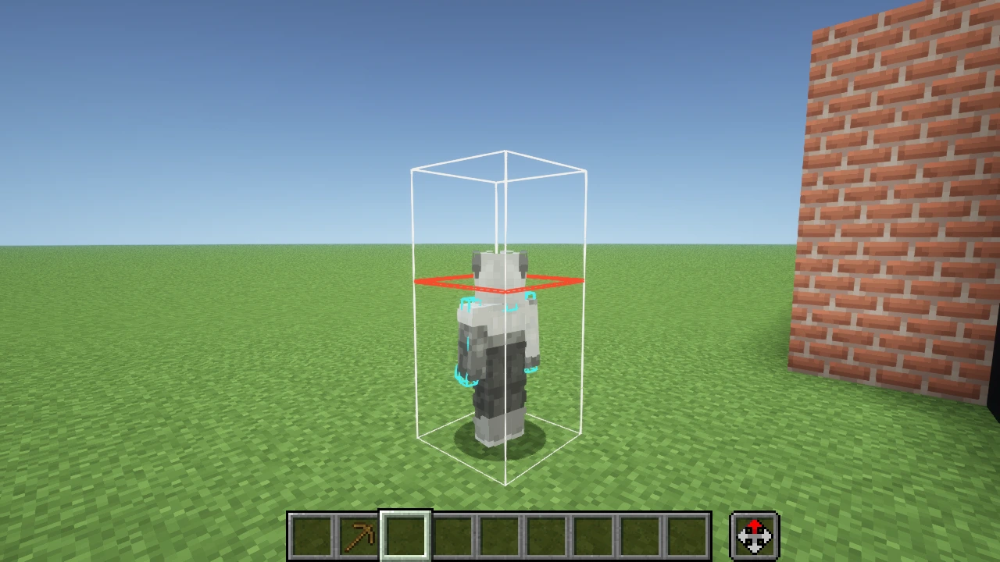

# figura_sillyplugin_but_ai_edited

> An **AI-assisted fork** of the Figura add-on [SillyPlugin](https://github.com/Figura-Solstice/SillyPlugin).
> It adds a Minecraft **1.21.8 (Fabric)** target (built against
> [figura_core_but_ai_edited](https://github.com/kwangsoo-assemble/figura_core_but_ai_edited)), a few new functions
> in the `silly` Lua API, and some `/figura` subcommands and a key binding.

> ⚠ **This is an unofficial fork** and is not affiliated with the original authors. Most changes were written with an
> AI coding assistant (Claude Code) and checked by the maintainer in real use. Before reporting a problem upstream,
> please make sure it is not caused by this fork.

## At a glance

| Item | Value |
|---|---|
| Version | `1.2.0-alpha.but-ai-edited.1` — a pre-release tag added to tell it apart from upstream 1.2.0-alpha (see 5) |
| Added target | Minecraft 1.21.8, Fabric |
| Upstream targets | 1.21.4 and 1.21.1 (Fabric, NeoForge), 1.20.1 (Fabric) — the version folders are still there, but they **do not build right now** (see "Building") |
| Figura for 1.21.8 | figura_core_but_ai_edited `0.1.6-but-ai-edited.1+1.21.8` (not on the official Maven) |
| Java | 21 |
| Build setup | Stonecutter (multi-version) + modstitch (loader abstraction), as in upstream |

## Changes from upstream

Compared against upstream branch `master` at [`828e5ed`](https://github.com/Figura-Solstice/SillyPlugin/commit/828e5edfc9cc5a9b84368bb9d2b84f01e1e70f2d).
The **Code** paths under each item are relative to `src/main/java/dev/celestial/silly/`, except build files and
`versions/`, which are relative to the repository root. **(new)** marks files that upstream does not have.

### 1. Minecraft 1.21.8 (Fabric) target

Adapted to the large rendering changes in 1.21.6.

- `GuiGraphics.pose()` is now a 2D matrix stack (`Matrix3x2fStack`) — only the 2D affine part of a 4×4 matrix is
  applied (no 3D skew in `setGuiMatrix` and `pushPoseMatrix`).
- Image drawing uses `RenderPipelines.GUI_TEXTURED`.
- The inventory entity rendering API changed, so `blitEntity` is an approximation.
- The experience bar and jump meter moved to `ContextualBarRenderer` — HUD hiding wraps the call sites inside
  `renderHotbarAndDecorations` and handles each kind.
- Adapted to API changes in NBT, entity constructors, texture atlas GPU readback and more.
- On 1.21.8 the add-on references **the build jar of figura_core_but_ai_edited** from `.libs/` instead of the official
  Maven (see "Building").

Code: `settings.gradle.kts` · `stonecutter.gradle.kts` · `build.gradle.kts` · `versions/1.21.8-fabric/` (new) ·
`lua/LuaGraphicsAPI.java` · `mixin/hud/GuiMixin.java` · `SillyUtil.java` · `lua/BackportsAPI.java` · `mixin/LocalPlayerMixin.java`

### 2. New Lua functions (`silly`)

- **`silly:getCameraType()`** → `"FIRST_PERSON"`, `"THIRD_PERSON_BACK"` or `"THIRD_PERSON_FRONT"` — the camera mode of
  the viewing client. Figura's `renderer:isFirstPerson()` is only true for the avatar's owner; this function tells
  **other players' avatar scripts too** whether the screen is in first person.
- **`silly:isFirstPerson()`** → the boolean version of the above.
- **`silly:getThirdPersonRot(part)`** and **`silly:getThirdPersonPos(part)`** → the **third-person** rotation (degrees)
  and position of a vanilla part, even in first person. The signs and units match `vanilla_model`'s `getOriginRot()`
  and `getOriginPos()`, so they can be dropped in place. Avatars that copy your pose into the world (mirror
  reflections, clones and so on) keep moving naturally in first person, arms and crouching included.
  - `part` — `"HEAD"`, `"BODY"`, `"RIGHT_ARM"`, `"LEFT_ARM"`, `"RIGHT_LEG"`, `"LEFT_LEG"`
  - They return values **only when the avatar's owner is the local player**, and `nil` otherwise — other players'
    avatars are rendered in third person, so `vanilla_model` is already correct for them.
- **`silly:getSkinModel(player or name[, callback])`** → `"SLIM"` or `"WIDE"`. Works for players who are not online,
  through the profile cache and the session server. When given a name it is **asynchronous** and answers through
  the callback.
- **`silly:setBoundingBoxScale(...)`** → scales the hitbox width and height of the player wearing the avatar
  (vec2, two values or one value, 0.05–16; call with no arguments to reset).
  - Eye height stays vanilla (so the camera and look direction do not drift from the server).
  - **Client-side display only** — the server's real hitbox does not change.
  - Resets automatically when the avatar is cleaned up.



*`silly:setBoundingBoxScale` — the hitbox (white box) grows, while the eye height (red line) stays vanilla.*

Code: `lua/SillyAPI.java` · three new files — `helper/ThirdPersonPose.java`, `mixin/PlayerRendererInvoker.java`, `mixin/PlayerDimensionsMixin.java`

### 3. `/figura` subcommands — `upload` and `reload` scopes

Adds subcommands to the `/figura` command of figura_core_but_ai_edited (using only that fork's public API).

- `/figura upload <main|server|both>` — uploads the avatar you are wearing.
  `main` is the official cloud, `server` is the server you are connected to (FSB), `both` is both.
- `/figura reload self|nonhost|all` — adds a scope to `/figura reload`.
  `self` is your own avatar (the same as `/figura reload` with no argument), `nonhost` is every avatar except yours,
  `all` is everything.

Code: `SillyCommands.java` · `mixin/FiguraCommandsMixin.java` (both new)

### 4. Key binding — reload all avatars

Figura's reload key only reloads your own avatar. This makes the "Reload all" button from the wardrobe permissions tab
available as a key. Unbound by default.

Code: `mixin/SillyKeybindMixin.java` (new) · `SillySettings.java`

### 5. Version number

To avoid confusion with upstream 1.2.0-alpha, the version carries an extra [SemVer pre-release](https://semver.org/#spec-item-9) tag —
`1.2.0-alpha.but-ai-edited.1` (jar: `sillyplugin-1.2.0-alpha.but-ai-edited.1.jar`). The last number is this fork's own release number.

Code: `gradle.properties`

The new mixins are registered in `src/main/resources/sillyplugin.mixins.json`, and the setting and doc strings are in
`src/main/resources/assets/sillyplugin/lang/en_us.json`.

> Note — the cheat gate is unchanged from upstream. Cheat-like features such as movement and physics control work only
> with **operator permission, creative mode, singleplayer, or a server MOTD opt-in**, and a MOTD opt-out always turns
> them off.

## Building

JDK 21 is required. **Only the 1.21.8-fabric target has been built and tested.**

```
# 1) Build figura_core_but_ai_edited and put its jar in .libs/
mkdir .libs
cp ../figura_core_but_ai_edited/fabric/build/libs/figura-0.1.6-but-ai-edited.1+1.21.8-fabric-mc.jar .libs/

# 2) 1.21.8-fabric (the active target)
./gradlew :1.21.8-fabric:build
```

Output: `versions/1.21.8-fabric/build/libs/sillyplugin-1.2.0-alpha.but-ai-edited.1.jar`

- ⚠ The other targets keep only their upstream version folders and **do not build as things stand.** Code added in
  this fork uses a 1.21.2+ API (`PlayerRenderState`) and an API that exists only in figura_core_but_ai_edited
  (`NetworkStuff.Destination`) without version conditions, so `chiseledBuild` does not pass either.

## License

**MIT**, the same as upstream (`LICENSE.txt`). Parts that come from the template are under `TEMPLATE_LICENSE` (CC0),
and the upstream README is kept as `README.upstream.md`.
